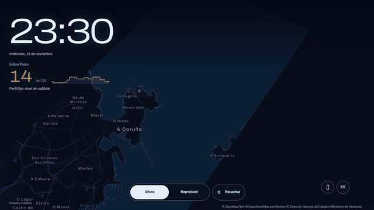

# Pulso A Coruña

A Coruña como organismo vivo: buses, BiciCoruña, viento, mareas, barcos, calidad del aire y aviones sobre un mapa 3D nocturno, con una máquina del tiempo (**Reproducir**), un modo sonoro (**Escuchar**) y un índice **Pulso** (0–100) que resume cuánta actividad hay respecto a lo habitual. PWA en gallego, español e inglés. Proyecto de portfolio, sin monetización.



_Demo de ~11 s con **datos simulados** (`dev:mock`), hora fijada a la noche del 18-nov-2026 y Chrome con GPU de escritorio. Los buses, bicis, barcos y el viento de la imagen son sintéticos; el índice Pulso se etiqueta en la propia web como «perfil fijo: nivel sin calibrar»._

## Estado

Desarrollo completado hasta M8 salvo las tareas humanas (y esta documentación, M8.6): todavía **no hay despliegue público**. Pendiente de una persona: prueba en móvil real (M8.3), contacto institucional con el Concello y la Compañía de Tranvías (M8.7) y salida por pasos (M8.8). Checklist en [`docs/TASKS.md`](docs/TASKS.md), plan en [`docs/ROADMAP.md`](docs/ROADMAP.md).

Datos que importa saber antes de mirar la demo:

- **Buses «según horario».** iTranvías (posiciones reales) está apagada hasta tener permiso: las posiciones de la capa de buses son una estimación calculada desde el GTFS y se rotulan como tal ([`docs/specs/M4.3a-estimador-bus.md`](docs/specs/M4.3a-estimador-bus.md)).
- **Índice Pulso con perfil fijo.** «Lo habitual» es una tabla estimada, no medida, hasta tener un mes de histórico propio ([ADR-0026](docs/ADR/0026-indice-pulso.md)).
- **Licencias de algunas fuentes pendientes de confirmar** (decisión humana); ver «Créditos».

## Qué muestra

| Capa       | Fuente (resumen)                           | Cómo se ve                                                  |
| ---------- | ------------------------------------------ | ----------------------------------------------------------- |
| Buses      | GTFS de la Compañía de Tranvías (estimado) | Estelas por línea; ficha con línea, destino, próxima parada |
| BiciCoruña | Estaciones de BiciCoruña                   | Anillos que se llenan y se vacían                           |
| Viento     | MeteoGalicia (3 estaciones)                | Partículas interpoladas entre estaciones                    |
| Marea      | Puertos del Estado (Portus)                | Nivel y marea en el puerto                                  |
| Barcos     | aisstream (AIS)                            | Barcos orientados; el MMSI no se guarda ni se expone        |
| Aire       | Open-Meteo / Calidade do Aire              | Halos por calidad                                           |
| Aviones    | OpenSky                                    | Trazas                                                      |

### Modos

- **Ahora**: estado en vivo recibido por WebSocket (snapshot al conectar y deltas cada ≤ 2 s).
- **Reproducir**: línea temporal con selector de día y velocidades 1×/60×/600× sobre el histórico grabado (30 días en bruto, después una muestra por minuto y entidad). Un día entero a 600× dura 2 min 24 s.
- **Escuchar**: sonificación con Web Audio nativo (pentatónica menor de La, ≤ 16 voces, apagada por defecto; suena en Ahora y en Reproducir). Ver [ADR-0027](docs/ADR/0027-diseno-sonoro.md).
- **Índice Pulso**: número 0–100 (50 = lo habitual para ese tipo de día y hora) con la serie del día. Fórmula y pesos en [ADR-0026](docs/ADR/0026-indice-pulso.md).
- También: enlace compartible que restaura cámara, capas, hora y modo; clip vertical de 15 s generado en el navegador; vista previa de enlaces con el índice real ([ADR-0029](docs/ADR/0029-clip-y-og.md)).

### Idiomas y accesibilidad

Gallego, español e inglés, sin cadenas fijas en el código (`apps/web/src/i18n/`). Teclado completo, `prefers-reduced-motion`, contraste AA y comprobaciones de daltonismo con tests ([ADR-0028](docs/ADR/0028-accesibilidad.md)).

## Arquitectura

```text
fuentes externas ──► apps/ingest ──► TimescaleDB ──► apps/api ──► (REST + WebSocket) ──► apps/web
 (HTTP, WS, GTFS)    adaptadores      (PostgreSQL)    Fastify          Caddy (HTTPS)       navegador
                     packages/adapters                                                    (+ teselas PMTiles propias)
                              └───────── packages/schema (Entity · StationStatus · Observation, zod) ─────────┘
```

| Pieza               | Qué hace                                                                                                                                                                     |
| ------------------- | ---------------------------------------------------------------------------------------------------------------------------------------------------------------------------- |
| `packages/schema`   | Contrato zod: todo dato externo se normaliza a `Entity`, `StationStatus` u `Observation`; mensaje WebSocket, ventanas de Reproducir y `Pulse`.                               |
| `packages/adapters` | Un adaptador por fuente (gtfs, itranvias, bicicoruna, meteogalicia, portus, openmeteo-air, aisstream, opensky), con fixtures grabadas: los tests nunca llaman a APIs reales. |
| `apps/ingest`       | Sondea las fuentes con intervalos, reintentos con espera creciente y `source_health`; escribe en TimescaleDB; agrega a 1 muestra/min y aplica la retención.                  |
| `apps/api`          | Fastify 5: `/api/v1/snapshot`, `/stream` (WebSocket), `/health`, `/replay` (MessagePack), `/pulse` y `/share`. Límites por IP.                                               |
| `apps/web`          | Vite + TypeScript sin framework, MapLibre GL + deck.gl. WebSocket, validación e interpolación en un Web Worker. PWA con caché de teselas.                                    |
| `infra/`            | Docker Compose (TimescaleDB, ingesta, API, backup diario), Caddy con HTTPS, y generación de las teselas PMTiles de A Coruña (Planetiler).                                    |

Regla de oro: **el navegador nunca llama a fuentes externas**, solo a nuestra API y a teselas propias. Se vigila con un test (0 peticiones a terceros). Todos los tiempos son UTC en epoch ms; `Europe/Madrid` solo al mostrar.

## Cómo correrlo

Requisitos: Node ≥ 20 y pnpm (`packageManager` fija `pnpm@11.0.9`; con Corepack basta `corepack enable`).

```bash
pnpm install

# 1) Teselas del mapa base (una vez; el .pmtiles no se versiona)
#    Generarlas con infra/tiles/README.md y copiarlas a apps/web/public/tiles/
pnpm --filter @pulso/web tiles:copy

# 2) Web con datos simulados (sin API ni base de datos)
pnpm --filter @pulso/web dev:mock       # http://localhost:5173
```

Con `dev:mock` hay un stream WebSocket simulado (`PULSO_MOCK_LIVE=1`, número de buses con `PULSO_MOCK_BUSES=n`) y mocks de Reproducir y del índice. Parámetros solo de desarrollo: `?t=2026-11-18T22:30:00Z` fija la hora, `?intro=0` salta la intro, `?orbit=1` añade una órbita lenta (ver [`apps/web/README.md`](apps/web/README.md)).

Calidad (la misma que exige el CI):

```bash
pnpm -r test          # Vitest
pnpm -r typecheck
pnpm -r lint
pnpm format:check     # Prettier
pnpm build
pnpm perf:bundle      # presupuesto de JS (build de producción + gzip)
pnpm perf:e2e         # fps y 0 peticiones a terceros (Playwright sobre Chrome)
```

Algunos tests de `apps/ingest` y `apps/api` usan una base TimescaleDB efímera con Docker ([ADR-0016](docs/ADR/0016-timescaledb-y-tests-efimeros.md)).

**Producción** (VPS con Docker Compose + Caddy, backup diario, restauración): [`docs/deploy.md`](docs/deploy.md). Qué decide el humano (dominio, claves, permisos): primera sección de esa guía.

## Decisiones clave

Todas las decisiones técnicas relevantes tienen un ADR corto en [`docs/ADR/`](docs/ADR/). Las que más condicionan el proyecto:

- Stack: [0001](docs/ADR/0001-stack.md), web sin framework [0008](docs/ADR/0008-web-vite-vanilla.md), render [0007](docs/ADR/0007-versiones-render.md).
- Mapa propio: teselas PMTiles con Planetiler [0009](docs/ADR/0009-teselas-pmtiles.md) y alturas reales de edificios con el Catastro [0013](docs/ADR/0013-alturas-reales.md).
- Datos: TimescaleDB [0016](docs/ADR/0016-timescaledb-y-tests-efimeros.md), API Fastify [0018](docs/ADR/0018-api-fastify.md), stream por sondeo de la BD [0019](docs/ADR/0019-stream-por-sondeo.md), retención con job gateado [0024](docs/ADR/0024-retencion-por-job-gateado.md), MessagePack para Reproducir [0025](docs/ADR/0025-msgpack-replay.md).
- Cliente en vivo: worker + deck.gl [0020](docs/ADR/0020-datos-en-vivo-worker-deck.md), estelas de bus [0022](docs/ADR/0022-geo-layers-trips.md).
- Producto: índice Pulso [0026](docs/ADR/0026-indice-pulso.md), sonido [0027](docs/ADR/0027-diseno-sonoro.md), accesibilidad [0028](docs/ADR/0028-accesibilidad.md), clip y OG [0029](docs/ADR/0029-clip-y-og.md).
- Presupuestos: CI de rendimiento [0011](docs/ADR/0011-ci-rendimiento.md); JS diferido [0021](docs/ADR/0021-presupuesto-js-diferido.md) y [0030](docs/ADR/0030-presupuesto-js-diferido-565.md).

El proyecto se desarrolla guiado por especificación (`docs/specs/`), con una rama y una PR por tarea ([`docs/WORKFLOW.md`](docs/WORKFLOW.md), [`AGENTS.md`](AGENTS.md)).

## Presupuestos y números reales

Presupuestos del ROADMAP ([`docs/ROADMAP.md`](docs/ROADMAP.md), «Presupuestos de rendimiento») frente a lo **medido**. Cada cifra indica de dónde sale; lo que no se ha medido figura como «pendiente».

| Métrica                                                | Presupuesto                          | Medido                                                                       | Origen                                                                                                                                               |
| ------------------------------------------------------ | ------------------------------------ | ---------------------------------------------------------------------------- | ---------------------------------------------------------------------------------------------------------------------------------------------------- |
| JS inicial (gzip, sin librería de mapa)                | < 250 KB                             | **15,6 KB**                                                                  | `pnpm perf:bundle` (23-nov-2026, `develop` tras M8.5)                                                                                                |
| Mapa + deck.gl + capas (gzip, diferido)                | < 565 KB (ADR-0030)                  | **560,5 KB** (margen ≈ 4,5 KB)                                               | `pnpm perf:bundle`, mismo día                                                                                                                        |
| Teselas del mapa base                                  | ≤ 15 MB                              | **8,04 MB** (7,67 MiB), `coruna.pmtiles`                                     | tamaño del fichero generado ([ADR-0009](docs/ADR/0009-teselas-pmtiles.md): 6,85 MB, 7,67 MB tras el Catastro, ADR-0013)                              |
| Edificios con altura real                              | —                                    | 28,8 % → **75,1 %** (ciudad: 93,8 %)                                         | [ADR-0013](docs/ADR/0013-alturas-reales.md)                                                                                                          |
| Peticiones del navegador a terceros                    | 0                                    | **0**                                                                        | test `third-party.spec.ts` (`pnpm perf:e2e`), pasa                                                                                                   |
| fps, GPU real de escritorio (Apple, Metal)             | media ≥ 58, p5 ≥ 50                  | **60,0 / 59,9** (5 s, 390×844, build de producción)                          | `PERF_FPS_PROFILE=gpu pnpm perf:e2e`, 23-nov-2026. No es un teléfono; sin CPU 4× ni datos en vivo (la prueba abre `/` sin API)                       |
| fps, WebGL por software (SwiftShader)                  | solo vigila regresiones (media ≥ 20) | 46,6 media (233 fotogramas en 5 s)                                           | `pnpm perf:e2e`, 23-nov-2026. **Sintético**: sin GPU, no representa un móvil                                                                         |
| fps a 600× y arrastre de la línea temporal             | 60 fps con GPU                       | GPU real: **60,0** media / 59,5 p5. SwiftShader 390×844: 21,6 / 19,8         | [`docs/specs/M6-puerta.md`](docs/specs/M6-puerta.md) («Números»), datos sintéticos de 60 h                                                           |
| Ventana de Reproducir (7 capas)                        | —                                    | ≈ 11 KB de media, máx. 13,2 KB; API p50 4–11 ms (desde el navegador, local)  | `docs/specs/M6-puerta.md`: datos sintéticos, API en la misma máquina, sin Caddy                                                                      |
| Hilo principal por fotograma (interpolación en worker) | < 8 ms                               | `engine.frames()` 0,05 ms de mediana por fotograma (banco en Node, worker)   | [`docs/specs/M4.2-cliente-ws-interpolacion.md`](docs/specs/M4.2-cliente-ws-interpolacion.md); es el coste del motor, no una traza de Chrome en móvil |
| Tests automáticos                                      | —                                    | **1258** en verde (62 schema, 134 adaptadores, 870 web, 135 API, 57 ingesta) | `pnpm -r test`, 23-nov-2026                                                                                                                          |
| Primer fotograma, LCP, INP en móvil real               | < 2,0 s · < 2,5 s · < 100 ms         | **pendiente**                                                                | M8.3, protocolo en [`docs/launch/M8.3-movil-real.md`](docs/launch/M8.3-movil-real.md)                                                                |
| Móvil real antiguo (fps, degradación automática)       | media ≥ 58, p5 ≥ 50                  | **pendiente**                                                                | M8.3 (humano)                                                                                                                                        |
| Coste real de producción (VPS, tráfico)                | ≤ 10 €/mes (objetivo)                | **pendiente**                                                                | M8.8 (humano); [`docs/launch/M8.8-salida-por-pasos.md`](docs/launch/M8.8-salida-por-pasos.md)                                                        |

Cómo leer la tabla: los fps de escritorio demuestran que el render y el worker no tienen cuellos de botella propios, **no** que un móvil de gama media llegue a 60 fps; esa es precisamente la prueba pendiente de M8.3. La degradación automática (menos partículas y estelas si baja de 45 fps durante 3 s) existe y tiene tests, pero su efecto en un dispositivo lento tampoco se ha medido.

## Créditos y estado de las fuentes

Atribuciones y licencias de las fuentes de datos (Open-Meteo, OpenStreetMap, Catastro, MeteoGalicia, Puertos del Estado, OpenSky, aisstream, BiciCoruña, iTranvías, GTFS) y estado en vivo de cada una: enlace **«Estado y créditos»** en la propia web. El catálogo está en [`apps/web/src/status/sources.ts`](apps/web/src/status/sources.ts), transcrito de [`docs/sources/`](docs/sources/) (una nota por fuente: URL, licencia, frecuencia y respuesta de ejemplo); las licencias marcadas «pendiente de confirmar» las decide una persona. Spec: [`docs/specs/M8.4-estado-creditos.md`](docs/specs/M8.4-estado-creditos.md).

Mapa base: © OpenMapTiles, © OpenStreetMap contributors (ODbL) y © Dirección General del Catastro (Ministerio de Hacienda) para las alturas de edificios. Este proyecto no está afiliado al Concello da Coruña ni a la Compañía de Tranvías.

## Licencia

**Pendiente de decisión humana.** El repositorio todavía no incluye un fichero `LICENSE`: hasta que se elija, no se concede ninguna licencia de uso, copia ni distribución del código.

## Más documentación

[`docs/SPEC.md`](docs/SPEC.md) (qué es y qué no) · [`docs/design/`](docs/design/) (dirección de arte) · [`docs/TOOLING.md`](docs/TOOLING.md) · [`docs/post/pulso-coruna-post-tecnico.md`](docs/post/pulso-coruna-post-tecnico.md) (borrador de post técnico, sin publicar).
